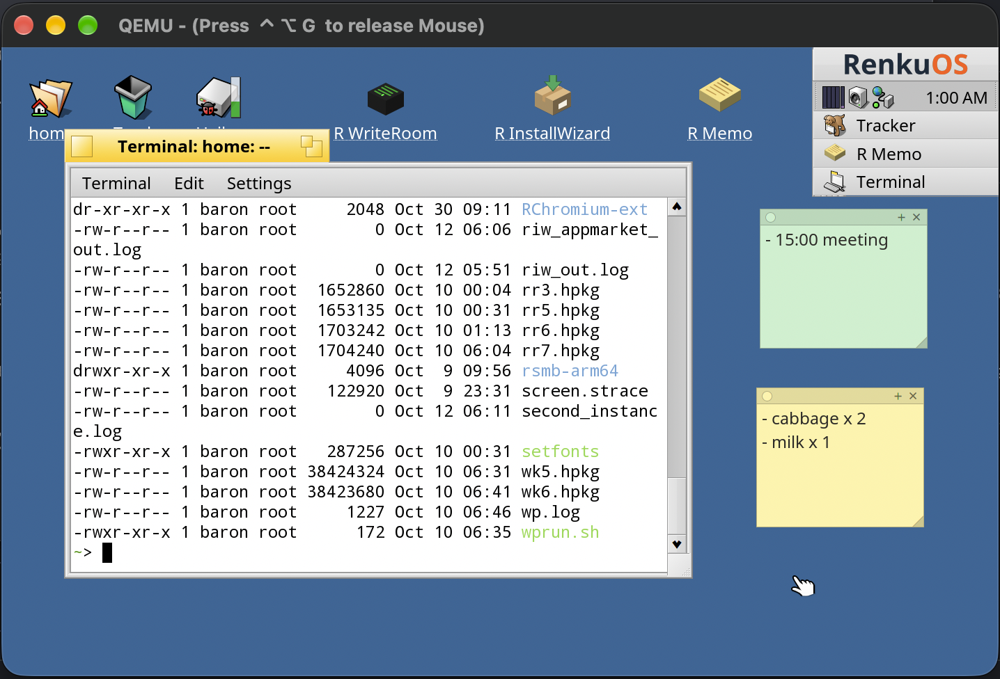

# MacRenkuOS

[한국어](README.ko.md)

Run [RenkuOS](https://github.com/rainygirl/renkuos-arm64) on Apple
Silicon, from the Terminal, with one command.



## Install

```sh
curl -fsSL https://raw.githubusercontent.com/rainygirl/MacRenkuOS/main/macrenkuos.sh | bash
```

It installs Homebrew and QEMU if either is missing (asking first),
downloads the live ISO on first run, and boots straight to a full-screen
RenkuOS desktop under QEMU. No `.app`, no `.dmg`, no Gatekeeper/
notarization step. It also installs itself as a `renkuos` command, so
next time you can just run:

```sh
renkuos
```

## Requirements

- Apple Silicon Mac, macOS 13+.
- Internet access on first run (to install Homebrew/QEMU if missing, to
  fetch the launcher files, and to download the live ISO, ~450MB).

## Using it

Every launch boots the same live medium; there is nothing to install and
nothing to click through. Writes persist in a qcow2 overlay next to the
ISO (delete
`~/Library/Application Support/Renku/renku-arm64-live-overlay.qcow2` to
reset to a pristine live session) -- so shut the guest down properly
(Deskbar > Shut Down) before closing the window or quitting QEMU, the
same way you would an installed disk.
